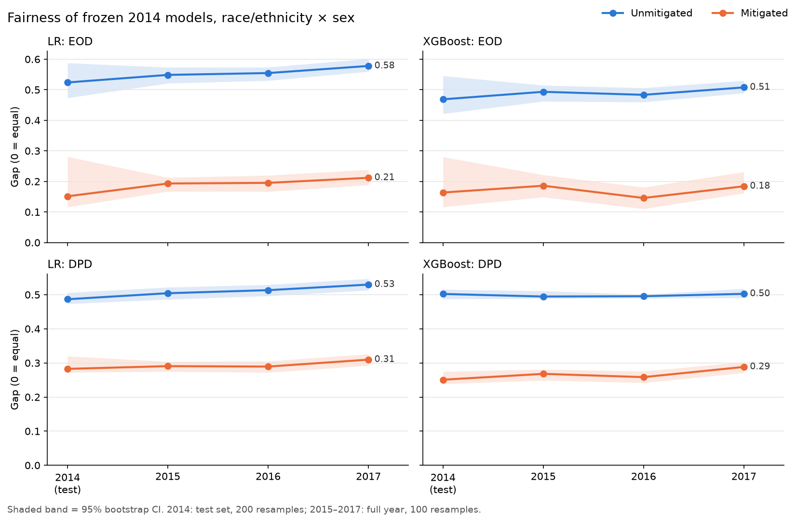

# Fairness Over Time

**Does a model that is fair when deployed stay fair as data changes over time?**

Income models (does a person earn more than \$50K?) are trained on Texas census data from 2014, made fairer with a fairness constraint, then **frozen** and run on 2015–2017 without retraining. The project measures what happens to their fairness, explains why it changes, and compares six ways to fix it.

**Live app:** [fairness-over-time.streamlit.app](https://fairness-over-time.streamlit.app)

| Question | Short answer |
|---|---|
| **RQ1** · Does fairness hold over time? | Mostly, but it **erodes gradually and unevenly**. No model collapses, and the benefit of mitigation survives. |
| **RQ2** · Why does it change? | **Concept drift meets a fixed cutoff.** The inputs barely change, but more people with the same features now earn over \$50K, and the 2014 cutoff misses them unevenly across groups. |
| **RQ3** · Which fix keeps it fair most cheaply? | **Group-specific cutoffs** refitted on new data: about half the fairness gap of the 2014 mitigated models, in seconds, for both model types, at about 2.4 points of accuracy. |

---

## Key findings

### Baseline (2014)
On the held-out 2014 test set (25,408 people), the unmitigated models are accurate but unfair across the 10 race/ethnicity × sex groups. Among people who really earn over \$50K, unmitigated XGBoost catches about 84% of non-Hispanic White men but only about 37% of Hispanic women. Fairness mitigation cuts the intersectional equalized odds difference (EOD) by **71% (logistic regression)** and **65% (XGBoost)**, for **1.1–1.3 points of accuracy**.

| Model (2014 test set) | Accuracy | AUC | EOD, race/ethnicity × sex [95% CI] |
|---|---|---|---|
| Logistic regression | 0.821 | 0.888 | 0.524 [0.473, 0.588] |
| Logistic regression, mitigated | 0.810 | 0.806\* | 0.151 [0.116, 0.281] |
| XGBoost | 0.827 | 0.896 | 0.469 [0.421, 0.546] |
| XGBoost, mitigated | 0.814 | 0.796\* | 0.164 [0.117, 0.280] |

\* Mitigated AUC comes from an ensemble vote share, not a calibrated probability, so it is not comparable with the other AUCs.

### RQ1: Fairness erodes slowly and unevenly



- **No model collapses.** The largest change in any gap from 2014 to 2017 is about +0.06.
- **Mitigation's benefit survives.** In 2017 the mitigated models' EOD (0.21 LR, 0.18 XGBoost) is still far below the unmitigated models' (0.58, 0.51).
- **Unmitigated logistic regression gets steadily worse;** unmitigated XGBoost is flat on demographic parity, and its EOD change is within noise.
- **Accuracy falls 1.2–1.3 points for every model while AUC stays flat:** the models still rank people well, but the 2014 decision cutoff no longer fits the 2017 population.

### RQ2: Concept drift meets a fixed cutoff
1. **The label moved.** The share of workers earning over \$50K rose from 31.6% to 35.4%. About **84% of that rise is real income growth** and only 16% is inflation (the fixed \$50K line losing value, measured with CPI-U).
2. **The inputs barely moved.** Every feature's population stability index (PSI) is below 0.02, far under the usual 0.1 "small shift" line. Only education drifts clearly (more people with higher degrees).
3. **The models use the inputs the same way every year.** SHAP feature importance is flat (all changes ≤ 0.05, rankings unchanged).
4. **So the old cutoff misses people unevenly.** Newly high-earning people in groups the models already scored low (women and Hispanic men) mostly fall below the 2014 cutoff, so those groups' true-positive rates fall, while non-Hispanic Asian men's rate rises. The gap opens at both ends, and EOD goes up. The pattern is shared by all four models, so it comes from the data, not from one model.

### RQ3: Which maintenance strategy?
Scenario: at the end of 2016, with 2016 labels available, each strategy is fitted on 2016 and tested on all of 2017.

| Strategy | Fairness (EOD, 2017) | Accuracy | Time to fit | Works for both models? |
|---|---|---|---|---|
| S0 · Do nothing | Worst (0.51–0.58) | Middle | 0 | — |
| S0m · Keep the 2014 mitigated model | Moderate (0.18–0.21) | Lower | 0 | Yes |
| S1 · One new cutoff | Poor (0.48–0.53) | Higher | < 1 s | Yes |
| **S2 · Group-specific cutoffs** (Fairlearn `ThresholdOptimizer`) | **Best (0.10–0.11)** | Lowest | **~2 s** | **Yes** |
| S3 · Retrain | Poor (0.46–0.51) | Highest | 5–11 s | Yes |
| S4 · Retrain + re-mitigate | Best for XGBoost (0.11), not LR (0.26) | Lower | 9–16 min | **No** |

- **Retraining (S3) and a new single cutoff (S1) only undo the drift:** fairness returns to the 2014 level, no better. Fixing accuracy does not fix fairness.
- **Keeping the 2014 mitigated model is free** and still gives moderate fairness three years later.
- **Group-specific cutoffs (S2) are the cheapest reliable fix,** but they apply explicit group-based thresholds and randomized decisions near each cutoff, which many real settings do not allow. **Where that is not allowed, retraining with mitigation (S4) on XGBoost is the better choice:** as fair as S2 and 1.5 points more accurate, at the cost of a longer fit and a check of the small groups every time.

---

## Data and design

**Data.** [Folktables](https://github.com/socialfoundations/folktables) ACSIncome task, built on the US Census American Community Survey (ACS) 1-year person files for **Texas, 2014–2017** (127,039 working adults in 2014, up to 133,880 in 2017). Label: personal income over \$50,000.

**Why these years and this state.**
- **2018 is excluded** because the Census changed its occupation codes that year, which would create artificial drift. Occupation codes were checked to mean the same thing in 2014–2017.
- **2020 is avoided** because the pandemic disrupted data collection.
- **Texas** covers the 2014–2016 oil-price crash and the 2017 recovery, a natural source of economic change.

**Features (10).** Age, class of worker, education, marital status, occupation, place of birth, relationship in household, hours worked per week, sex and race/ethnicity.

**Groups.** Sex, race/ethnicity and their **10 intersections**. Race/ethnicity combines race and Hispanic origin into 5 groups: Hispanic (any race), and non-Hispanic White, Black, Asian and Other. This keeps Hispanic Texans (about 31% of the data) visible instead of splitting them across race categories.

**Models.** Logistic regression and XGBoost, each in two versions:
- **Unmitigated:** trained for accuracy only.
- **Mitigated:** Fairlearn's `ExponentiatedGradient` with an **equalized odds** constraint on the 10 race/ethnicity × sex groups. The result is a weighted ensemble of inner models; predictions use its vote share with a 0.5 cutoff (deterministic, instead of Fairlearn's randomized predictions).

Every model is a scikit-learn `Pipeline` whose preprocessing is fitted on 2014 training data only and never refitted on later years.

**Phases.**

| Phase | What it does | Notebook |
|---|---|---|
| 1 · Baseline | Train on 2014 (60/20/20 split, stratified by label × race/ethnicity × sex), measure accuracy and fairness, mitigate, freeze 4 models | `01_baseline.ipynb` |
| 2 · Monitor | Run the frozen models on 2015–2017; accuracy, AUC, demographic parity difference (DPD) and EOD by group, with bootstrap 95% CIs | `02_monitor.ipynb` |
| 3 · Diagnose | Label drift vs. inflation, feature drift (PSI/KS), SHAP importance over time, per-group true-positive rates | `03_diagnose.ipynb` |
| 4 · Fix | Six maintenance strategies fitted on 2016, compared on 2017 for fairness, accuracy and cost | `04_fix.ipynb` |

**Fairness metrics.**
- **Equalized odds difference (EOD, main metric):** the largest gap between groups in true-positive rate or false-positive rate.
- **Demographic parity difference (DPD):** the largest gap between groups in the share predicted over \$50K. DPD also moves when the real share of high earners changes in a group, so it is read with care.

---

## The app

The [Streamlit app](https://fairness-over-time.streamlit.app) presents the results. It **never trains**: it only reads the saved models and result files in `artifacts/`.

| Page | What it shows |
|---|---|
| **Home** | The question, the three answers, and how to use the app |
| **Baseline** | 2014 accuracy and fairness of the 4 models; who the models miss; why accuracy hides unfairness |
| **Fairness Over Time** | The headline result: EOD and DPD for 2014–2017 with confidence bands (RQ1) |
| **Why It Changed** | Label drift, feature drift, SHAP over time and per-group true-positive rates (RQ2) |
| **Fix Comparison** | The six strategies on fairness, accuracy and cost (RQ3) |
| **Try a Profile** | Enter one person: predictions from all 4 models, a SHAP explanation, and a what-if grid that changes only sex and race/ethnicity |

---

## Repository structure

```
fairness-over-time/
├── src/                     # reusable code, shared by the notebooks and the app
│   ├── data.py              # load ACS data, build race/ethnicity, train/test split, artifact paths
│   ├── preprocess.py        # preprocessing (one-hot encoding, scaling)
│   ├── models.py            # model pipelines, mitigation, threshold strategies, load_models()
│   ├── fairness.py          # per-group metrics, DPD/EOD, bootstrap CIs, save_results()
│   ├── drift.py             # label drift (CPI-adjusted), PSI/KS feature drift
│   ├── explain.py           # SHAP explanations summed back to the 10 raw features
│   └── lookups.py           # builds the code → label table used by the app
├── notebooks/               # one notebook per phase (01_baseline … 04_fix)
├── artifacts/               # the contract between the notebooks and the app
│   ├── models/              # 4 frozen models (.joblib)
│   ├── results/             # result CSVs (metrics, CIs, drift, SHAP, fix comparison, 2014 split)
│   └── background_sample.csv  # 500 rows of 2014 training data used as the SHAP reference
├── app/                     # Streamlit app: Home.py, pages/, utils.py (cached loaders)
├── data/
│   ├── raw/                 # ACS files, downloaded automatically (not committed)
│   └── lookups/             # feature_codes.csv: code → label for occupations, birthplaces, etc.
├── reports/                 # saved figures
├── environment-dev.yml      # full development environment (conda)
├── requirements.txt         # app-only dependencies (Streamlit Community Cloud)
└── pyproject.toml           # makes src/ installable with pip install -e .
```

**Result files in `artifacts/results/`:**

| File | Contents |
|---|---|
| `metrics_over_time.csv` | Accuracy, AUC, per-group metrics and DPD/EOD for each model and year |
| `ci_over_time.csv` | 95% bootstrap confidence intervals for DPD and EOD |
| `label_drift.csv` | Share earning over \$50K per year: fixed vs. inflation-adjusted line |
| `drift_over_time.csv` | PSI and KS per feature (2014 test vs. 2014 train = noise floor) |
| `shap_over_time.csv` | Mean \|SHAP\| per feature, year and model |
| `fix_comparison.csv` | All metrics for the six strategies on 2017 |
| `split_2014.csv` | Row IDs of the 2014 train/validation/test split |

---

## Reproduce it

**1. Set up the environment** (Python 3.11, conda):
```bash
conda env create -f environment-dev.yml
conda activate fairness
pip install -e .
```

**2. Run the notebooks in order:** `01_baseline` → `02_monitor` → `03_diagnose` → `04_fix`. The ACS files for Texas are downloaded automatically into `data/raw/` the first time (about 250 MB per year). Each notebook writes its results to `artifacts/`.

**3. Run the app:**
```bash
streamlit run app/Home.py
```

**Optional: rebuild the code → label table.** Download the [2017 ACS PUMS data dictionary (CSV)](https://www2.census.gov/programs-surveys/acs/tech_docs/pums/data_dict/PUMS_Data_Dictionary_2017.csv) into `data/raw/`, then run:
```bash
python -m src.lookups
```
The 2017 dictionary is used for all years because it is the first one published as CSV and the codes of these features are the same in 2014–2017. The script keeps only the occupation (315) and birthplace (98) codes the models learned from, and flags any code without a label.

---

## Deployment notes

The app runs on Streamlit Community Cloud, which installs from `requirements.txt` (app dependencies only), not from `environment-dev.yml`.

- **Server Python is 3.12** (local development uses 3.11). The models were saved with xgboost 3.4.2, a conda-forge build that is not on PyPI; PyPI's closest version, 3.4.1, requires Python ≥ 3.12. Predictions were checked to match between the two setups.
- **scikit-learn and xgboost must stay in sync** between `environment-dev.yml` and `requirements.txt`, because the saved models depend on them.
- **The line `-e .` in `requirements.txt`** installs `src/` on the server, so the app can import it.
- **After changing `app/utils.py` or anything in `src/`, reboot the app** (Manage app → Reboot): Streamlit reloads page files automatically but not always helper modules.

---

## Limitations

- **One state, four years.** Results may differ for other states or longer periods.
- **Sex and race/ethnicity are model inputs on purpose,** so SHAP and the what-if grid can measure how much the models rely on them. This is a research model for studying fairness over time, not a decision system: using protected attributes directly is generally not allowed in US hiring or lending.
- **The mitigated models use sex and race/ethnicity directly and sharply.** For some individual profiles, changing only race/ethnicity moves the mitigated XGBoost score from about 0 to about 0.9. They equalize error rates across groups by treating groups differently.
- **Small groups are noisy.** Non-Hispanic Asian and Other groups have only about 40–60 people earning over \$50K in the 2014 test set; changes below about 0.05 in their rates are not meaningful.
- **Thresholded mitigation.** The mitigated models use deterministic predictions, so Fairlearn's fairness guarantee (stated for randomized predictions) does not strictly apply.
- **Phase 4 is a best case:** it assumes 2016 labels are available at the end of 2016 (in practice ACS data is published about a year later), uses one fit year and one test year, and reports point estimates without bootstrap intervals. Retraining used 1.7× more rows than the 2014 training set.
- **Inflation share** uses national CPI-U, not Texas prices, and is likely a lower bound because reported incomes cluster at round numbers.

## Future work

- **LIME** case studies as a local cross-check of the SHAP explanations.
- **Batch upload in the app:** predictions, fairness metrics and drift for a whole CSV, compared with 2014.
- A model **without sex and race/ethnicity** as inputs, to show how far proxy features (occupation, household role) carry the same information.
- **More years and states,** with a mapping between the old and new occupation codes to include 2018 onwards.
